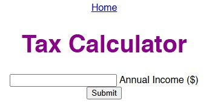

# Tax Calculator

Simple calculator for progressive task, built with Flask in Visual Studio Code

## Built with:
- Python
- Flask

## Running locally:
1. `pip install flask`
2. `python app.py`
3. Open `http://127.0.0.1:5000`

## Screenshot
